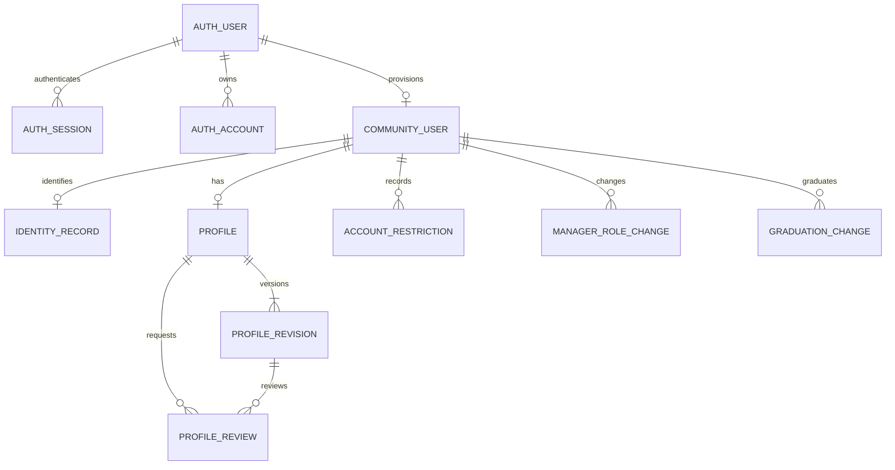
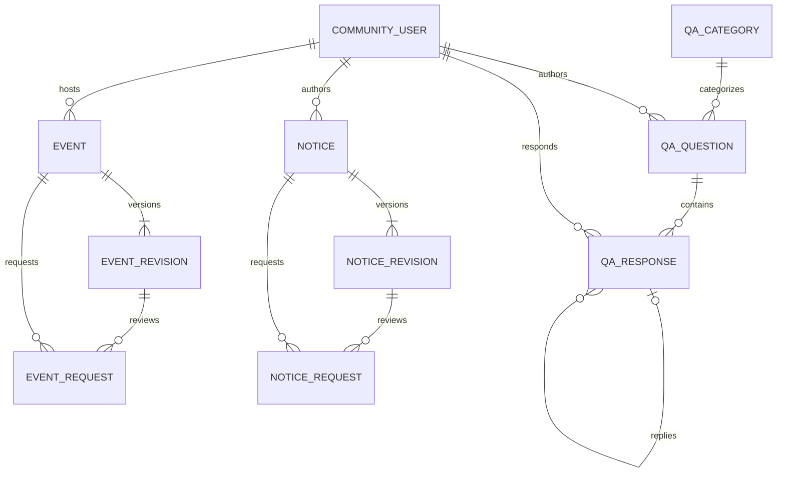
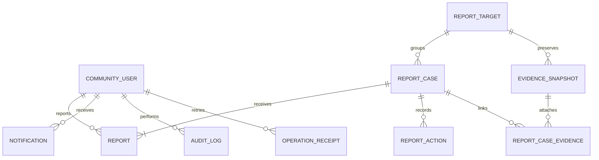

# After School Project PoC DB・ER設計書 v0.1

作成日 2026-11-11

## 1. 設計の前提

[技術決定書](./After_School_Project_PoC_技術構成・認証方式決定書_v0.1.md)に従い、Neon PostgreSQL・Drizzle ORM・pgを使用する。本書は論理テーブルと主要な列・制約・トランザクションの設計。認証テーブルは基盤構築で採用版から生成し、実際のマイグレーションで列名・型・既定値を照合する。[画面遷移](./After_School_Project_PoC_画面遷移・状態遷移設計書_v0.1.md)と[共通認可](./After_School_Project_PoC_共通認可条件表_v0.1.md)を取得・更新の契約とする。

基本所属はstudent／alumni／staff、管理権限は学校管理者・アプリ管理者の別属性。卒業予定は在校生の状態。学校管理者に関する制限を先に判定し、追加のアプリ管理権限で解除しない。

## 2. ID・時刻・更新番号

- Better Authの利用者IDは生成されるstringをそのままtextで参照する。アプリの利用者行も同じIDを主キーとする。
- その他のアプリレコードはUUIDを主キーとする。照合用にタイトルや表示名を識別子として使用しない。
- 瞬間を表す日時はtimestamptzで保存する。開催日の入力・表示・当日判定・翌日00:00の算出はAsia/Tokyoに統一する。
- 更新競合のある利用者・プロフィール・申請・案件・投稿本体に整数のversionを持たせる。画面が表示したversionを更新時に照合する。
- 本書の列名はsnake_case。外部キーの参照先IDの型を一致させ、必要なNOT NULL・CHECK・UNIQUE・外部キーをマイグレーションへ反映する。

## 3. 認証・所属・プロフィール

| 論理テーブル | 主な列 | 制約・扱い |
|---|---|---|
| auth_user | id、name、email、email_verified、username等 | Better AuthのUserモデル。usernameの正規化・一意性を保証。PoCのemailは架空アドレス、email_verifiedはfalse。学校確認済みとは別管理 |
| auth_session | id、user_id、token、expires_at等 | Better AuthのSessionモデル。DB照会・8時間固定期限・Cookieキャッシュ無効 |
| auth_account | id、user_id、provider_id、account_id、password等 | Better AuthのAccountモデル。credentialパスワードはライブラリによるハッシュのみ |
| auth_verification | id、identifier、value、expires_at等 | 採用版が要求するVerificationモデルを生成する。PoCでメール確認経路を公開しない |
| auth_rate_limit | id、key、count、last_request等 | DB保存する認証回数制限の生成モデル。期限処理を認証ライブラリの仕様に合わせる |
| community_users | user_id PK/FK、base_role、is_graduating、school_manager、app_manager、account_status、profile_state、eligibility_status、provisioning_status、version | account_statusはactive／suspended、profile_stateはpublic／hidden。発行完了かつ学校確認済みで利用可。is_graduating=trueはstudentのみ。学校管理者はstaff。認可に関わる状態を同じ利用者行でロックする |
| identity_records | user_id PK/FK、private_real_name、school_reference、verification_note | 本人確認用の非公開情報。学校管理者専用。メールはauth_userの値を参照し、架空アドレスを確認済み連絡先と表示しない |
| profiles | user_id PK/FK、current_revision_id、search_opt_in、version | 最新の保存済みプロフィール版を参照する。公開可否はcommunity_users.profile_stateで判定。検索掲載希望の初期値はfalse。本人フォームのversionで保存競合を検出 |
| profile_revisions | id、user_id FK、revision_no、display_name、department、entry_year、graduation_year、optional_values JSONB、field_visibility JSONB、created_at | UNIQUE(user_id, revision_no)。保存ごとに不変の版を作る。任意項目のキーと公開範囲を許可リストで検証。表示名の実名方針はOP-05に従い、PoCは架空表示名 |
| profile_reviews | id、user_id FK、revision_id FK、status、version、submitted_at、reviewer_id、decision_reason、decided_at | pending／approved／rejected。1人につきpendingは最大1件。非表示本人の再保存でpendingの審査対象版とversionを更新。過去の確定済み審査は保持 |
| account_restrictions | id、user_id FK、actor_id FK、action、public_reason、internal_reason、created_at | 停止・解除の理由を別保存し両方必須。本人にはpublic_reasonのみ。内部記録には操作権限を適用 |
| manager_role_changes | id、user_id FK、actor_id FK、before_app_manager、after_app_manager、created_at | 学校管理者がアプリ管理権限を付与・解除した履歴。学校管理者の追加・退任を扱うUIは設けない |
| graduation_changes | id、batch_id、user_id FK、actor_id FK、before_role、after_role、before_graduating、after_graduating、created_at | 卒業一括変更・誤変更修正の履歴。対象の利用者ID・投稿・プロフィール版を作り直さない |

`profiles.current_revision_id`と`profile_reviews.revision_id`は、同じuser_idの版だけを指す複合外部キーで保証する。プロフィールの公開版は、profile_state=publicのときのcurrent_revision。hiddenのときも本人は最新の保存内容を取得できる。

認証コアとプラグインのモデルは公式のスキーマ生成に従う。表のauth接頭辞は論理名であり、物理名はアダプター設定と生成結果で対応付ける。[Better Authのデータモデル](https://better-auth.com/docs/concepts/database)

### プロフィールの項目別公開

企画者回答により、任意項目は項目ごとにmembers（承認済みの全利用者）／self（本人のみ）を選択する。任意項目の初期候補は `bio`（自己紹介）、`occupation`（職種）、`interests`（関心分野）。各値は文字列で、公開範囲の未設定はselfとして扱う。非公開項目を他人向け検索や再公開審査の取得データへ含めない。

本人のフォームから更新できるのはdisplay_nameと任意項目・公開範囲・掲載希望。所属・学科・年度・本人確認情報は学校側の投入データまたは学校専用処理で管理する。公開プロフィールの表示にはprofilesの現在版を使用し、認証ライブラリの汎用ユーザー名更新でプロフィール審査を迂回できないようにする。

検索条件は、掲載希望あり・profile_state=public・学校確認済み・発行完了・卒業生または卒業予定の在校生。閲覧者の停止判定と、掲載対象の公開条件を分けて扱う。

## 4. Q&Aと公開版・申請版

| 論理テーブル | 主な列 | 制約・扱い |
|---|---|---|
| qa_categories | id、code UNIQUE、name | 就職・キャリア、技術・学習、制作・プロジェクト、雑談の4件を初期投入 |
| qa_questions | id、author_id FK、category_id FK、title、body_markdown、resolution、forced_hidden_at、deleted_at、author_label、version、created_at、updated_at | resolutionはopen／resolved。本人削除後はタイトル・本文を公開取得しない。子を残すため本体IDを維持し、削除前に必要な証拠を別保全 |
| qa_responses | id、question_id FK、author_id FK、kind、parent_response_id FK nullable、body_markdown、forced_hidden_at、deleted_at、author_label、version、created_at、updated_at | kindはanswer／comment／reply。親レスポンスは同じquestion_id内。answerは親なし、replyは親必須。親の変更を許可せず循環を防ぐ |
| notices | id、author_id FK、origin_kind、public_revision_id nullable、first_published_at、forced_hidden_at、deleted_at、version、created_at、updated_at | origin_kindはschool／alumniを作成時に記録。削除は論理削除、復元不可。公開版への参照と公開・削除状態を分ける |
| notice_revisions | id、notice_id FK、revision_no、title、body、category_code、created_at | 不変の内容版。UNIQUE(notice_id, revision_no)。カテゴリー名称はOP-08、PoCの仮値を使用 |
| notice_requests | id、notice_id FK、revision_id FK、request_kind、status、submitted_at、reviewer_id FK nullable、decision_reason、decided_at、withdrawal_reason、version | request_kindはnew／edit、statusはpending／approved／rejected／withdrawn。お知らせのpending版は編集不可。再申請は新レコード |
| events | id、author_id FK、origin_kind、public_revision_id nullable、first_published_at、cancelled_at、cancellation_reason、forced_hidden_at、version、created_at、updated_at | origin_kindはstaff／student／alumniを作成時に記録。開催と強制非表示を別判定。主催者による削除なし |
| event_revisions | id、event_id FK、revision_no、title、description、starts_at、ends_at nullable、format、venue、participation_info、external_url nullable、created_at | formatはin_person／online／hybrid。終了指定時は開始より後。形式ごとの場所・参加方法はサーバーで必須検証 |
| event_requests | id、event_id FK、revision_id FK、request_kind、status、submitted_at、reviewer_id FK nullable、decision_reason、decided_at、withdrawal_reason、version | 同じ申請中の修正は新しい不変版へ差し替え、submitted_atを維持してversionを増やす。却下理由必須 |

各本体のpublic_revision_idと各申請のrevision_idは、その本体に属する版だけを指す複合外部キーで制約する。本体を未公開・公開版参照なしで作成し、版の作成後に参照を設定する順序で同じトランザクションに収める。

qa_responsesは `(parent_response_id, question_id)` を `(id, question_id)` に参照させる。本人削除では子を連鎖削除しない。削除済み本文は一般・本人・通常管理の取得から除外し、証拠取得の学校専用経路を使用する。公開状態の異なる親子はそれぞれの状態を確認し、非表示の親本文を残存スレッドに混入させない。

お知らせ・イベントの公開版は承認時にpublic_revision_idを切り替える。申請が却下・取り下げになっても旧公開版参照を変更しない。公開後編集の承認と強制非表示の解除を別操作とする。

### 開催状態の算出

保存する中止状態はcancelled_at。中止があれば開催中止、それ以外で有効な終了時刻以上なら開催終了、それ以外は開催予定。一般公開では公開版の日時を使い、編集申請だけで開催状態を変更しない。終了時刻は、ends_atまたは開始日の翌日00:00 JST。

公開本体の有効終了時刻に達したらpending編集申請を自動取り下げし、未承認の将来日時で開催を延長しない。新規未公開申請は申請版の日付を用いて要開催日修正を判定する。企画者回答により中止後の本文・日時を含む通常編集を拒否する。強制非表示・復元でcancelled_atとcancellation_reasonを変更しない。

## 5. 通報・証拠・通知・監査

| 論理テーブル | 主な列 | 制約・扱い |
|---|---|---|
| report_targets | id、kind、subject_user_id nullable FK、question_id nullable FK、response_id nullable FK | kindはaccount／profile／question／response。種別に対応した参照を1つだけ設定。プロフィールとアカウントはkindとuser_idの組で識別。お知らせ・イベントを表す種別なし |
| report_cases | id、target_id FK、status、priority、assignee_id nullable FK、handoff_pending、school_only、version、created_at、closed_at nullable | statusはunhandled／in_progress／closed、priorityはunset／normal／high。原則担当1人。引継ぎ待ちのときだけ担当NULL。対象ごとの未終了案件は最大1件 |
| reports | id、case_id FK、reporter_id FK、reason_code、detail nullable、created_at | 6理由をCHECK、detailは500文字以内。otherは空白以外の詳細必須。送信後の本人編集・削除なし |
| report_actions | id、case_id FK、actor_id FK、action_type、before_state、after_state、note、created_at | 状態・優先度・担当・引継ぎ・措置の追記履歴。自動引継ぎにも契機を記録 |
| evidence_snapshots | id、target_id FK、source_revision、snapshot JSONB、captured_at | 通報対象の必要な表示内容を別保全。通報受領時と証拠に関係する更新・削除前に保存。本人確認情報を公開内容のスナップショットへ混ぜない |
| report_case_evidence | case_id FK、evidence_id FK、PRIMARY KEY(case_id, evidence_id) | 同じ証拠と複数案件の関係を保持。関連する最後の案件の終了時刻から保存期限を算出 |
| notifications | id、recipient_id FK、kind、qa_question_id／qa_response_id／notice_request_id／event_request_id／profile_review_id／profile_user_idの各nullable FK、event_key、public_message、read_at nullable、created_at | kindに対応する対象参照を1つだけ設定。UNIQUE(recipient_id, event_key)。送信者ではなく受信者が既読更新。未読件数も最新の認可を適用 |
| audit_logs | id、actor_id nullable FK、system_action、action_type、target_type、target_id、before_state、after_state、public_reason、created_at | 操作と対象を記録。対象削除後も対象IDを保持するため、target_idは削除連鎖の対象にしない。秘密値・投稿本文・非公開本人確認情報をコピーしない |
| operation_receipts | id、actor_id FK、request_key、request_hash、result_type、result_id、created_at | UNIQUE(actor_id, request_key)。同一キー・同一内容の再送は重複処理せず、結果参照を現在の権限で返す。異なる内容の同一キーは409相当 |

report_targetsは外部キーと種別・NULL条件を組み合わせて存在を保証する。利用者ID・質問ID・回答IDを根拠なく共通のtarget_id欄へ入れる実装は避ける。audit_logsの履歴上の対象IDと、通常取得で解決する外部キーを使い分ける。

証拠の保存期限は、同じtarget_idに関連する全案件の状態を含めて評価する。report_case_evidenceは案件画面からの証拠参照にも使用し、新規案件や削除前の保全時に必要な関連付けを追加する。

### 受領・担当・引継ぎ

通報受領と同時に、同一対象の未終了案件へ統合するか新規案件を作る。初期担当は発行済みの学校管理者を指定する設計判断。初期担当を得られない場合は、学校専用の引継ぎ待ちにして一時未割当とする。どちらの場合も通報自体を失わず、本人には受付完了だけを表示する。

アプリ管理者の管理機能喪失、削除済み証拠への移行、対象者のアプリ管理者化で必要な制限が発生したら、未対応・対応中の担当案件を同じトランザクションで引継ぎ待ちへ移す。案件の対応状態・過去履歴を維持する。school_onlyは一度trueになれば維持し、読取時にも現在の対象者権限を確認する。

### 通知の生成

- Q&Aの新しい回答は質問者、コメント・返信は直接の親投稿者へ通知する。自己通知は送らない設計判断。
- お知らせ・イベントの審査依頼は審査可能な管理者へ、承認・却下は申請者へ通知する。自己審査依頼、取り下げ・終了・中止の追加一斉通知は生成しない。
- プロフィール再公開の結果は本人へ通知し、却下時は理由を含める。Q&A等の非表示理由通知は原要件に従う。
- 登録審査通知、お知らせ公開一斉通知、通報対応結果の本人通知、お知らせ・イベント強制非表示／復元の個別通知は生成しない。
- 通知には現在の権限で取得できない対象のタイトルや本文を残さず、表示時に必要な情報を再取得する。既読の保存と対象閲覧の権限を別々に確認する。

## 6. 主な制約・索引

| 対象 | 制約・索引 |
|---|---|
| 発行・利用者 | username正規化後のUNIQUE。base_role・状態のCHECK、is_graduatingならstudent。auth_userとの一対一外部キー |
| プロフィール版 | UNIQUE(user_id, revision_no)、UNIQUE(user_id, id)。profilesと審査は複合外部キーで本人の版だけ参照 |
| 再公開審査 | user_idについてstatus=pendingの部分UNIQUE |
| 新規・編集申請 | 本体IDごとにstatus=pendingの部分UNIQUE。申請の提出日時とIDによる審査順索引。未承認版を一般検索対象にしない |
| Q&Aの親子 | UNIQUE(id, question_id)、同一質問内の複合外部キー。自分自身を親にできないCHECK、親の変更をアプリで拒否 |
| 公開本体・版 | UNIQUE(本体ID, id)を版に設け、公開版参照と申請版参照に複合外部キーを設定 |
| イベント | ends_at IS NULLまたはends_at > starts_at。開始日が当日以降という実行時条件はサーバー判定 |
| 通報対象 | kindと対応する1本の外部キーの整合をCHECK。種別別の対象参照をUNIQUE |
| 通報案件 | target_idについてstatusが未対応／対応中の部分UNIQUE。handoff_pendingと担当NULLの組合せをCHECK |
| 一覧 | Q&Aのcategory_id・created_at・id、各公開一覧の日時・id、本人一覧のauthor_id・日時・id |
| 通知 | recipient_id・created_at・id、未読に絞ったrecipient_idの索引、recipient_id・event_keyのUNIQUE |
| 外部キー | 所有者・受信者・申請者・担当者・親・本体参照に、取得条件に合う索引を設ける。複合索引は先頭列を確認して重複を避ける |

現在時刻や別行の状態に依存する条件をCHECKや部分索引へ埋め込まない。外部キー・一意制約で保証する条件と、トランザクション内で判定する条件を分ける。[PostgreSQLの制約](https://www.postgresql.org/docs/current/ddl-constraints.html)、[部分索引](https://www.postgresql.org/docs/current/indexes-partial.html)

## 7. トランザクションと期限

| 処理 | 同じトランザクションで確定する内容 |
|---|---|
| プロフィール保存 | 利用者・最新versionの照合、不変版作成、最新参照更新、非表示中ならpending審査の作成／対象版更新 |
| 再公開承認・却下 | 審査権限と表示したversion照合、申請確定、承認時のprofile_state更新、結果通知・監査 |
| 新規申請・再申請 | 本体・版・申請と受付順、通知、再送キー。通常の再申請で古い申請状態を上書きしない |
| 審査 | 所有者・状態・versionの照合、申請確定、必要な公開版参照切替、通知・監査。編集承認で強制非表示を変更しない |
| 本人削除・中止 | 確認・権限・期限の照合、論理削除／中止、pending編集の自動取り下げ、必要な証拠保全・引継ぎ、履歴 |
| アプリ管理機能喪失 | 管理権限・停止・プロフィール状態の変更、対象となる担当案件の引継ぎ、履歴・監査 |
| 通報受付 | 対象と通報資格の確認、案件の作成または統合、担当、通報本文、証拠と関連付け、再送キー |
| 卒業区分変更 | 変更対象と変更前versionの照合、所属・卒業予定状態の更新、変更履歴・監査。PoCの一括操作は全対象を原子的に確定 |

ロック順序・再送キー・競合時の扱いは共通認可条件表5節に従う。認証ライブラリのユーザー作成とアプリ側の発行準備が分かれる場合、community_users.provisioning_statusがreadyになるまでログイン後の利用を拒否する。

イベントの読み書き時に行う期限同期は、既存DBの日時に基づくシステム処理とする。利用者のGETに任意の更新内容を受け付ける機能を設けず、必要なロックを取得した後のDBの現在時刻で終了・自動取り下げを確定する。履歴にはシステム実行と終了を契機としたことを記録する。ロック待ちの前に取得した時刻だけで更新を許可しない。

| 保存対象 | 期限とPoCでの処理 |
|---|---|
| 削除済みお知らせ本体・版 | deleted_atから180日。期限到来後は本人・学校管理者・申請履歴経由を含め本文取得を拒否し、本人一覧から除外 |
| 通報案件・対応履歴 | 案件の最後の終了から1年。再開した場合は終了日時を再評価する |
| 削除対象の別保全証拠 | 関連案件がすべて終了してから、最後の終了時刻を基準に180日。未終了案件があれば消去期限を確定しない |
| 操作ログ | 操作から1年 |

通報案件・証拠・操作ログも、期限到来後は通常の取得から除外するPoC設計とする。定期消去は後続で実装し、その間の物理保存と閲覧期限を分ける。削除済みお知らせの本体期限で、別保全証拠・監査ログを連鎖消去しない。

アプリ用DBロールは必要なテーブルの読取・更新を許可し、履歴・証拠・監査を扱う共通サーバー処理で利用者別の認可を適用する。操作ログのUPDATE・DELETE権限はアプリ用ロールに与えない。マイグレーション・将来の期限消去は別の管理用ロールで行う。RLSを追加する場合も既存の共通認可を維持し、ポリシーと接続ロールをDB実装時に確認する。

## 8. 最初の実装と後続の詳細化

最初のマイグレーションは認証生成モデル、community_users、identity_records、profiles、profile_revisions、profile_reviewsを中心とする。Q&A・お知らせ・イベント・通報のテーブルは関係を本書で予約し、対応機能の着手前に列・索引・削除規則を補完する。既存モデルへ別の利用者IDを追加しない。

本書にあるER図はMermaid形式。実DBでの制約・ロック・マイグレーション・索引の成立と性能は基盤構築および各機能の実装で検証する。
