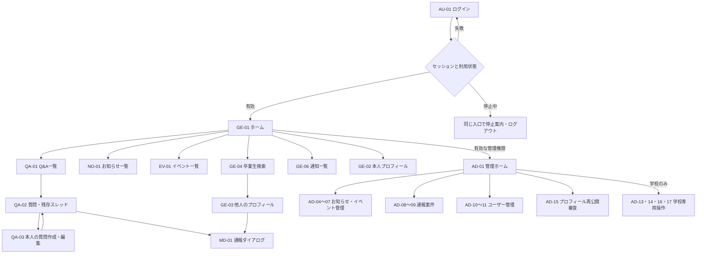
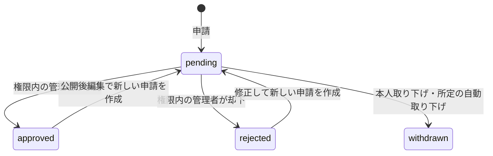
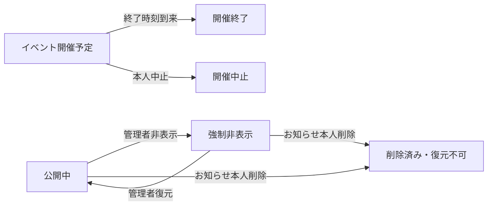

# After School Project PoC 画面遷移・状態遷移設計書 v0.1

作成日 2026-11-11

更新日 2026-11-12。API契約と確定した操作条件の参照先を追加。

## 1. 設計の範囲

[画面一覧 v0.2](./After_School_Project_PoC_画面一覧設計書_v0.2.md)の35管理単位を、URL・遷移・例外状態へ具体化する。認証は[技術決定書](./After_School_Project_PoC_技術構成・認証方式決定書_v0.1.md)、操作の許否は[共通認可条件表](./After_School_Project_PoC_共通認可条件表_v0.1.md)、保存する状態は[DB・ER設計書](./After_School_Project_PoC_DB・ER設計書_v0.1.md)を参照する。

本書のURLと表示件数は設計判断。画面IDを実装・Issue・受入確認の参照単位として維持する。AD-14はPoC補完設計案を継続して記載する。

## 2. URLと表示形式

角括弧の値は対象レコードのID。URL・クエリーにあるIDを受け取った後、サーバーで本人・対象・状態を確認する。統合表示のクエリーは選択状態だけを表し、認可を付与しない。

| 画面ID | URL・配置 | 主な入口・戻り先 |
|---|---|---|
| AU-01 | `/login` | 未認証時。成功後は権限内の戻り先、指定がなければGE-01 |
| GE-01 | `/` | ログイン後・共通ナビ。Q&A・お知らせ・イベント・通知の各一覧／詳細へ |
| GE-02 | `/me/profile` | 本人メニュー。保存後も同画面に残り結果を表示 |
| GE-03 | `/users/[userId]` | 著者リンク・GE-04。本人ならGE-02へ移動可能 |
| GE-04 | `/alumni` | 共通ナビ。検索結果からGE-03へ |
| GE-05 | `/me/questions` | 本人メニュー。本人の質問・回答等からQA-02へ |
| GE-06 | `/notifications` | ヘッダー・GE-01。通知対象を再認可して詳細へ |
| QA-01 | `/questions` | 共通ナビ・GE-01。QA-02／QA-03へ |
| QA-02 | `/questions/[questionId]` | 一覧・GE-05・通知。回答・コメント・返信・削除確認・管理操作を統合 |
| QA-03 | `/questions/new`、`/questions/[questionId]/edit` | 新規作成・本人編集。保存後QA-02、キャンセルは遷移元 |
| NO-01 | `/notices` | 共通ナビ・GE-01。NO-02へ |
| NO-02 | `/notices/[noticeId]` | 一般一覧・通知。公開版を表示 |
| NO-03 | `/notices/new`、`/me/notices/[noticeId]/edit` | 新規・本人一覧。送信後は即時公開ならNO-02、申請ならNO-04内のNO-05 |
| NO-04 | `/me/notices` | 本人メニュー。公開本体・削除済み本体の権限付き閲覧と削除確認もここで表示 |
| NO-05 | NO-04内の詳細ビュー。`?notice=[noticeId]&request=[requestId]` | 本人の申請履歴。取り下げ後は履歴、却下後はNO-03へ |
| EV-01 | `/events` | 共通ナビ・GE-01。EV-02へ |
| EV-02 | `/events/[eventId]` | 一般一覧・通知。公開版と開催状態・外部URLの警告を表示 |
| EV-03 | `/events/new`、`/me/events/[eventId]/edit` | 新規・本人一覧・申請中修正。送信後は即時公開ならEV-02、申請ならEV-04内のEV-05 |
| EV-04 | `/me/events` | 本人メニュー。強制非表示本体の権限付き閲覧と中止確認もここで表示 |
| EV-05 | EV-04内の詳細ビュー。`?event=[eventId]&request=[requestId]` | 本人の申請履歴。審査中修正・却下後修正はEV-03へ |
| MD-01 | QA-02／GE-03上のダイアログ | 対象・理由入力 → 送信前確認 → 受付完了 → 元画面 |
| AD-01 | `/admin` | 有効な管理者の入口。3種の件数カードと権限内の管理メニュー |
| AD-04 | `/admin/notices` | 承認カード・管理メニュー。申請一覧／公開管理からAD-05へ |
| AD-05 | `/admin/notices/[noticeId]`。申請選択は `?request=[requestId]` | 新規・編集審査、公開版の強制非表示・復元、学校管理者の削除済み本文閲覧 |
| AD-06 | `/admin/events` | 承認カード・管理メニュー。申請一覧／公開管理からAD-07へ |
| AD-07 | `/admin/events/[eventId]`。申請選択は `?request=[requestId]` | 審査と公開管理。審査対象がない公開済みイベントも同画面で扱う |
| AD-08 | `/admin/reports` | 通報カード・管理メニュー。案件詳細と学校専用の引継ぎタブへ |
| AD-09 | `/admin/reports/[caseId]` | 案件の状態・優先度・担当・措置・対応履歴。証拠パネルを統合 |
| AD-10 | `/admin/users` | 管理メニュー。利用者検索からAD-11へ |
| AD-11 | `/admin/users/[userId]` | 対象者別の操作と確認。終了後も同画面で最新状態を表示 |
| AD-13 | `/admin/graduation` | 学校専用メニュー。対象・変更内容の確認 → 実行結果 |
| AD-14 | `/admin/audit-logs` | 学校専用メニュー。簡易一覧と選択したログの詳細（補完設計案） |
| AD-15 | `/admin/profile-reviews` | 管理メニュー。再公開申請の一覧と選択詳細を同一画面に表示 |
| AD-16 | AD-08内の学校専用タブ。`?tab=handoff` | 学校管理者が担当を再設定し、通常案件へ戻す |
| AD-17 | AD-09内の学校専用証拠パネル | 削除済み証拠は学校管理者だけが取得・表示 |

独立表示の画面テンプレートは30、統合表示は5。新規／編集フォームを別URLとして数えると画面URLパターンは33で、AD-14の提案分を含む。APIや静的ファイルのURLはこの集計に含めない。AU-02〜05、AD-02、AD-03、AD-12は予約IDを維持する。

## 3. 一般・本人・管理エリアの遷移

### 最初に実装する画面

| 画面 | 必要な表示・入力 | 保存・遷移とエラー |
|---|---|---|
| AU-01 | 学校発行ログインID、パスワード、ログインボタン、再発行の連絡先案内 | エラーはIDの存在を明かさない共通表示。成功後に状態を判定。`returnTo` は同一アプリの許可した相対パスだけを受け付け、遷移先でも認可する |
| GE-01 | 最新Q&A・新着お知らせ・開催予定イベント・直近通知を各5件、通知未読件数、共通ナビ、本人メニュー | 各一覧へ「すべて見る」を設ける。公開版・表示可能な対象だけ取得。管理入口は有効な管理権限のとき表示 |
| GE-02 | 公開表示名、所属・学科・年度の表示、任意項目、項目ごとの公開設定、検索掲載希望、保存、再公開申請結果 | 非公開本人確認情報・所属・管理権限はこのフォームで変更しない。修正中に他の更新が確定した場合は409相当で再読込を案内 |
| GE-03 | 公開条件を満たす項目、許可される通報入口 | 非表示プロフィールは状態案内。本人の編集はGE-02へ |
| GE-04 | キーワード・学科／年度の条件、掲載対象の結果 | 掲載希望と公開状態を満たす卒業生・卒業予定者のみ。非公開項目は検索にも使用しない |

ホームの各5件は本書で定めるPoCの初期表示値。Q&Aは新しい順、お知らせは初回公開日時の新しい順、開催予定イベントは有効な開催予定状態の開始日時順、通知は受信日時の新しい順とし、同時刻はIDで順序を固定する。開催中で終了していないイベントも既存の「開催予定」区分に含まれる。

プロフィールの任意項目は、企画者回答により項目ごとに「承認済みの全利用者に公開／本人のみ」を選択する。初期候補は自己紹介・職種・関心分野とし、空欄を許可する。未設定の公開範囲は「本人のみ」とする設計判断。実名・連絡先を任意公開項目へ自動転記しない。

最初のホーム実装ではナビ・認可・4領域の配置を用意し、各領域の実データは対応機能の完成後にロードマップ09で接続する。データが0件の場合は空状態を表示する。

### 初期入力・取得の契約

| 対象 | 入力・出力と検証 |
|---|---|
| 本人プロフィール取得 | 最新version、公開表示名、任意項目の本人用の全値、項目ごとの公開範囲、掲載希望、読み取り専用の所属・学科・年度、再公開審査状態を返す |
| 本人プロフィール保存 | API設計書のProfilePatchとしてexpectedVersion、displayName、optionalFields（bio・occupation・interestsの値と公開範囲）、searchOptInのみ受け付ける。所属・管理権限・本人確認情報などの追加フィールドは拒否 |
| 文字数の初期値 | display_nameは空白を除いて1〜50文字。bioは最大1000、occupationは最大100、interestsは最大200文字。任意項目は空欄可。サーバーで同じ条件を確認 |
| 他人プロフィール・検索 | 本人のみの任意項目は値と検索対象から除外。非表示プロフィールは項目を返さない |
| Markdown | 段落・見出し・強調・箇条書き・引用・コード・HTTP／HTTPSリンクを許可する初期設計。HTMLは実行可能なマークアップとして描画せず、画像・添付・iframe等は扱わない |

Markdownは許可構文とURLスキームをレンダラー側でも制限し、コード内の文字列をHTMLとして実行しない。入力文字数とMarkdownの構文はDES-03の設計判断で、実装時に入力フォームとサーバーの検証を揃える。

## 4. 通知・権限変更・例外

| 契機 | 表示・遷移 |
|---|---|
| セッション失効 | 個人データを返さずAU-01へ。再ログイン後に対象と現在の権限を再確認 |
| アカウント停止 | コミュニティ・通知・管理エリアを拒否し、本人向け停止理由とログアウトだけを案内 |
| プロフィール非表示 | GE-02で修正保存可。一般閲覧は維持し、新規投稿・既存編集とアプリ管理者の管理操作を拒否 |
| 管理権限解除 | ログインを維持。管理画面は権限変更の案内と一般ホームへの導線を表示し、管理データを返さない |
| 質問削除 | QA-02は削除案内と公開可能な残存回答・コメントを表示。質問本文を返さず、本人の残存回答からも到達可能 |
| 通知の対象が取り下げ済み | 操作不能の状態案内。管理者向けのお知らせ取り下げ通知リンクは申請本文を表示しない |
| 通知の対象が削除・非表示・権限外 | 通知本文・対象画面の双方で現在の表示条件を適用し、制限されたタイトル・本文を返さない |
| 存在しないID・他人の本人用ID | 対象が存在するかを明かさない404相当。管理エリアそのものへの資格がない場合は403相当 |
| 更新競合 | 最新状態に更新して操作をやり直す案内。失敗した操作の通知・監査成功記録は生成しない |

既読更新は受信者本人へのPOST相当の操作とし、通知一覧やリンクのGETだけでは既読状態を変更しない。対象への遷移に外部の任意URLを使わず、種別とIDから許可した画面URLを組み立てる。

## 5. お知らせ・イベントの申請状態

図の再申請・公開後編集は新しい申請IDを作る。過去の承認・却下・取り下げレコードは履歴として保持する。学校職員の即時公開・即時編集では、審査待ち申請を作らず公開版を切り替える。

| 状態・操作 | お知らせ | イベント |
|---|---|---|
| 審査待ちの本文修正 | 不可 | 本人が修正可。受付日時と申請IDを維持し、版と更新番号を変える |
| 管理者の審査 | 新規／編集とも自己審査不可 | 同左。新規申請の開始日が過去なら日付修正まで承認・却下不可 |
| 編集の承認待ち・却下・取り下げ | 旧公開版を維持 | 旧公開版を維持 |
| 本人による公開後の終了操作 | 最終確認して論理削除。保留中編集を自動取り下げ | 最終確認して中止。保留中編集を自動取り下げ |
| 終了日時到来 | — | 有効な終了時刻以降は編集・中止・保留中編集審査を拒否し、その編集申請を自動取り下げ |
| 中止後の本文・日時編集 | — | 企画者回答により不可。中止状態と理由も変更不可 |

## 6. 公開状態と開催状態

公開状態・削除・開催状態は別に保存・判定する。イベントの強制非表示・復元は終了・中止後も権限内で実行でき、開催状態と中止理由を変えない。公開版の編集承認でも強制非表示は解除しない。

終了時刻は、指定終了日時があればその時刻、なければ開始日の翌日00:00 JST。比較にはサーバー時刻を使う。古い画面を開いたままでも、実行時刻が境界に達していれば操作を拒否する。

プロフィール再公開では、非表示 → 本人修正保存による審査待ち → 承認による公開／却下による非表示を基本とする。審査中の再編集は可能で、審査時には表示した版との一致を確認する。

## 7. 次工程への受渡し

ログイン・一般ホーム・本人プロフィールから実装を始める。未決の表示名・お知らせカテゴリー・学校協議事項は原資料のIDで管理する。全画面のAPI対応、入力・返却値、エラー・競合条件は[API設計書](./After_School_Project_PoC_API設計書_v0.1.md)を参照する。各画面の詳細なワイヤーフレームは対応機能の実装前に補足する。

API設計時の企画者回答により、対応済み通報案件は閲覧専用で再開しない。引継ぎ待ちの通常の担当再設定は対応状態を維持し、学校管理者が完了操作をする場合だけ、実行者への担当設定・引継ぎ待ち解除・対応済みを同時確定する。卒業区分の誤変更は、学校管理者が在校生／卒業生と卒業予定状態を指定して修正する。
